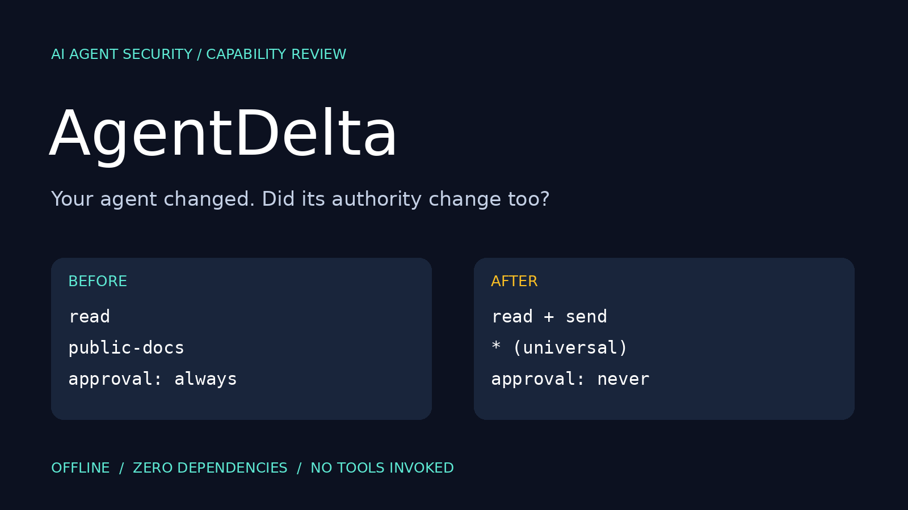
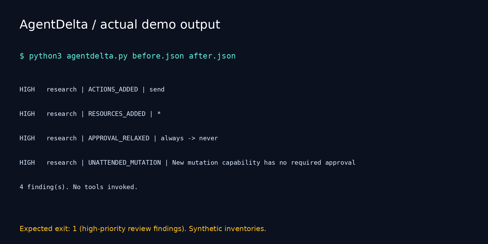

# AgentDelta



  

**Your agent changed. Did its authority change too?**

AgentDelta compares two explicit capability inventories and turns permission drift into a small, explainable security review. It highlights new actions, new resource labels, new tools and relaxed approval rules. It never invokes an agent, executes a tool, or contacts a server.

## What makes it useful

A source diff shows changed lines. AgentDelta gives those changes review-oriented meaning: did a read-only research tool gain the ability to send data, use universal resources, and operate without approval?

This is a focused prototype, not a claim of category-first invention, MCP compliance, or guaranteed protection. Inventories use the small schema below; they are not native MCP manifests.

## Quick start

Python 3.10+; no pip packages required. Download or clone this repository and open its directory:

```bash
python3 agentdelta.py before.json after.json
```

Windows: use `py -3` instead of `python3` where appropriate.

Actual demo output:

```text
HIGH   research | ACTIONS_ADDED | send
HIGH   research | RESOURCES_ADDED | *
HIGH   research | APPROVAL_RELAXED | always -> never
HIGH   research | UNATTENDED_MUTATION | New mutation capability has no required approval
4 finding(s). No tools invoked.
```

The default command returns exit code **1** for this demo because high-severity review findings are expected.

```bash
python3 agentdelta.py before.json after.json --json > report.json
python3 agentdelta.py before.json after.json --fail-on review
python3 agentdelta.py before.json after.json --fail-on never
python3 -m unittest discover -v
```

`--fail-on never` still prints findings but returns 0 for valid input. Invalid input always returns 2.

## Inventory schema

```json
{
  "tools": [
    {
      "name": "research",
      "actions": ["read"],
      "resources": ["public-docs"],
      "approval": "always"
    }
  ]
}
```

| Field | Allowed values / meaning |
| --- | --- |
| `name` | Unique stable tool identity, no outer whitespace |
| `actions` | Nonempty list from `read`, `write`, `delete`, `execute`, `send` |
| `resources` | Nonempty list of opaque resource labels; literal `*` means universal access |
| `approval` | `always`: every action requires approval; `writes`: mutations require approval; `never`: no approval required |

Both inventories must use the same naming and policy vocabulary. Unknown fields, unsupported actions, duplicate identities, duplicate array entries and malformed documents are rejected. An empty tools array is valid. Label semantics are supplied by the operator: `docs/*` and `docs/private` are just different labels, not interpreted paths. No wildcard matching except the literal universal `*` rule is performed.

## Rules

| Rule | Trigger | Severity |
| --- | --- | --- |
| `TOOL_ADDED` | A new identity appears | Review |
| `ACTIONS_ADDED` | New actions appear | High for send/delete/execute; otherwise review |
| `RESOURCES_ADDED` | New resource labels and previous resources lacked `*` | High for newly added `*`; otherwise review |
| `APPROVAL_RELAXED` | Approval moves toward `never` | High |
| `UNATTENDED_MUTATION` | New tool/action with mutation ability and `never` approval | High |
| `TOOL_REMOVED` | An identity disappears | Info |

These severities are review priorities, not exploitation probabilities. Changes to a source inventory cannot prove actual runtime authority. Existing unchanged risky configurations are outside drift analysis. Restrictions generally produce no findings. New identities are reviewed even if they are renamed old tools. JSON reports include SHA256 hashes of the exact input bytes for provenance; hashes are not signatures or proof of trust.

## CI integration

Use the CLI in your existing CI runner against a reviewed baseline and proposed inventory. Treat exit code 1 as a review gate, not a confirmed incident. Preserve and protect the baseline separately; if an attacker controls both files, they can hide drift.

## Tests

Nine standard-library tests cover unchanged configurations, privilege expansion, wildcard narrowing, approval tightening, removed/new identities, duplicate identities, unsupported actions and input hash output. Demo values are synthetic.

## Limitations

No live discovery, MCP server connections, prompt injection detection, enforcement, signature verification, path containment analysis, policy-language parser or source authenticity validation. Files are loaded in memory. Approval relaxation can be highlighted even when actions are currently read-only; this is intentionally conservative. Resource additions may be equivalent or narrower in an external policy language, so human review is required.

## Launch assets



See [POST.md](POST.md) for Arabic and English launch drafts.

Suggested GitHub topics: `ai-security`, `agent-security`, `permission-drift`, `least-privilege`, `blue-team`, `python`, `security-tools`, `devsecops`, `policy-as-code`.

Search phrases: AI agent permission drift, agent capability diff, tool permission review, least privilege for AI agents.
